# Drone Mission Planner — QGIS plugin & ArcGIS Pro toolbox  (v1.12)

Plan drone mapping missions from a drawn polygon/line or an imported GIS/CAD file, tune them for wind,
temperature, altitude and payload, plan the battery changes for big jobs and long linear features, and send
the flights to the aircraft. One shared planning engine
(`dronemapper_core`) drives both GIS front-ends, so both give identical missions.

Download the install zips from the repository's **Releases** page, or build them yourself (see *Development*).

| Package | Install |
|---|---|
| `drone_mission_planner_qgis.zip` | QGIS 3.22+ (Qt5) and QGIS 4 (Qt6): **Plugins ▸ Manage and Install Plugins ▸ Install from ZIP**. A toolbar button opens the planner panel. |
| `DroneMissionPlanner_ArcGISPro.zip` | ArcGIS Pro 2.9+: unzip anywhere, then **Catalog ▸ Toolboxes ▸ Add Toolbox** and pick `DroneMissionPlanner.pyt` (keep the `dronemapper_core` folder next to it). **Updating:** replace the whole `DroneMissionPlanner` folder and restart ArcGIS Pro. |

Live MAVLink upload needs **pymavlink** (optional):
- QGIS: open the *OSGeo4W Shell* → `python -m pip install pymavlink`, restart QGIS.
- ArcGIS Pro: *Package Manager* → clone the default environment → add `pymavlink` (or `python -m pip install pymavlink` in the clone's Python Command Prompt).

## Screenshots

*QGIS images: sample data near Perth, WA. These were rendered headless, so the QGIS panel and the mission layers are
shown side by side rather than inside the full QGIS window.*

**QGIS – area mission with two launch stations, a powerline obstacle and the planner panel**
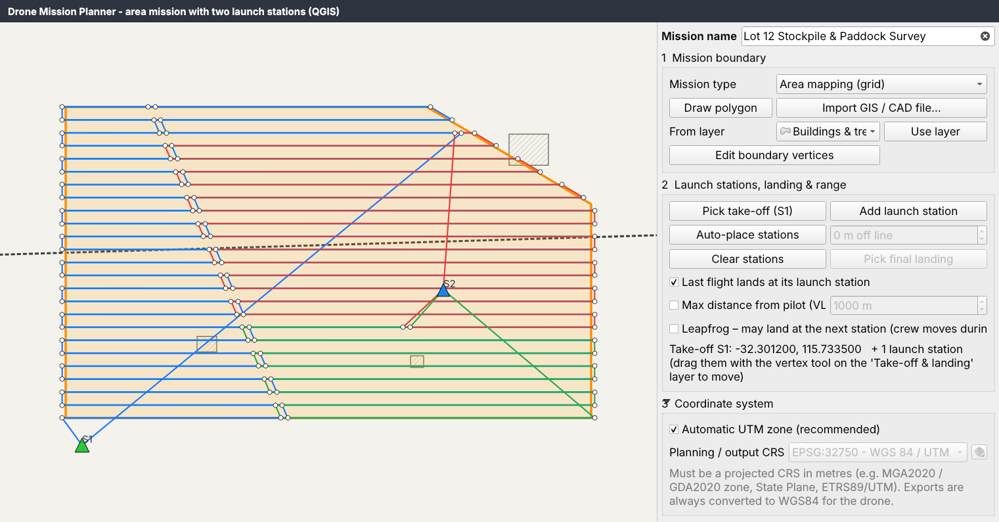

**QGIS – route / corridor mapping with auto-placed launch stations and chainage (KP)**
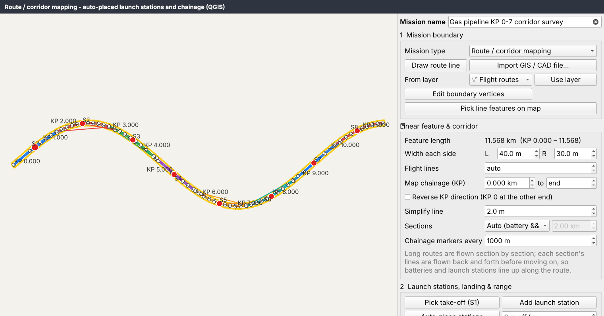

**QGIS – the mission report in the panel (heights, GSD, flights, batteries, field schedule, checks)**
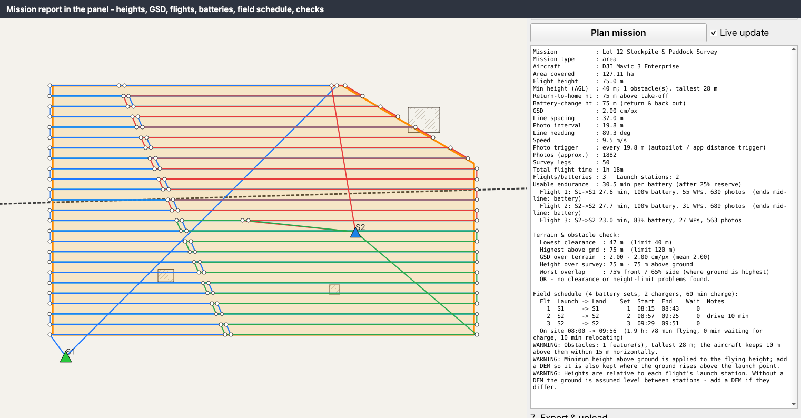

**Upload to drone – MAVLink, copy to controller / SD card, or replace a DJI Fly mission**
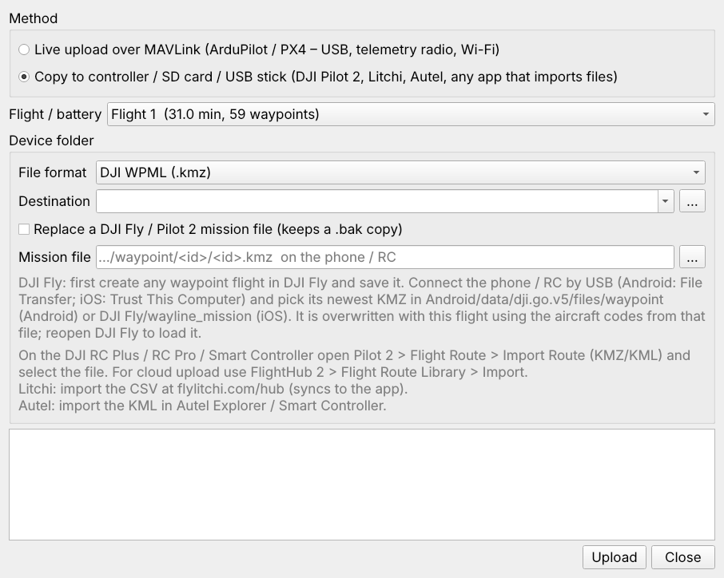

### ArcGIS Pro

Real missions planned with the ArcGIS Pro toolbox (DJI Matrice 300 RTK + P1, World Imagery basemap) – screenshots
from ArcGIS Pro.

**Area mission over an industrial complex** – photo footprints (yellow), take-off point (red), flight lines and
the aircraft overrides in the *Create Area Mapping Mission* tool
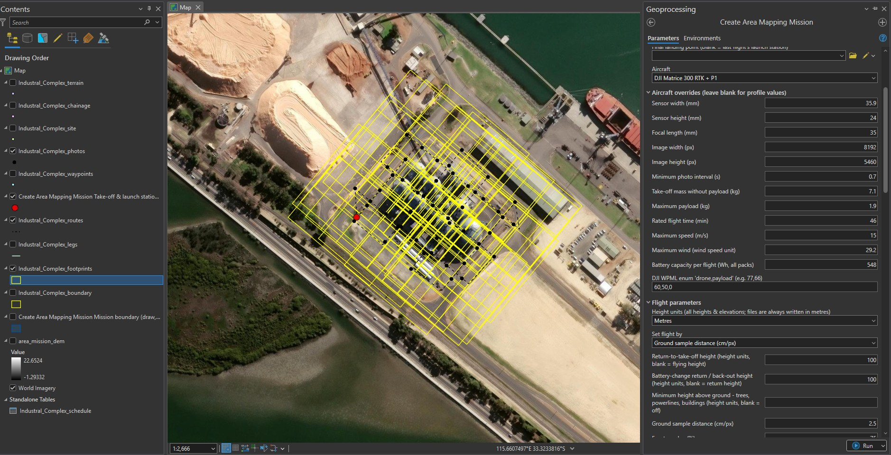

**Area mission over port stockpiles** – lines aligned with a 20 kn wind from 273°, photo footprints, red take-off
point and the flight parameters
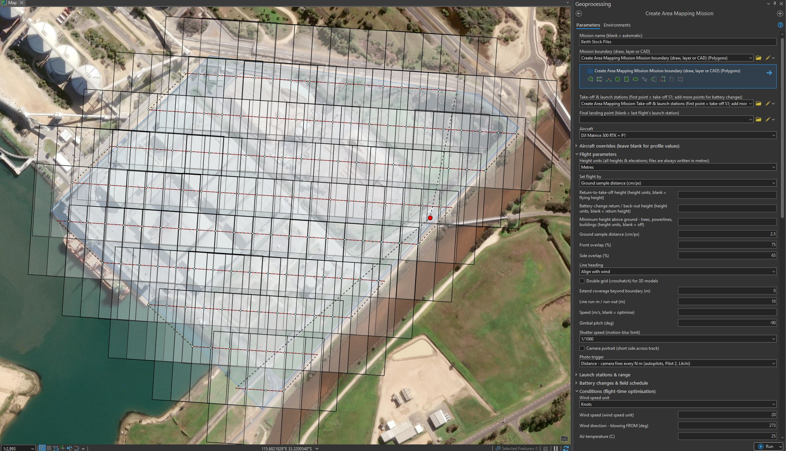

**Route / corridor mission along a railway** – corridor footprints (yellow), waypoints and flight lines with the
*Create Route Mapping Mission* tool
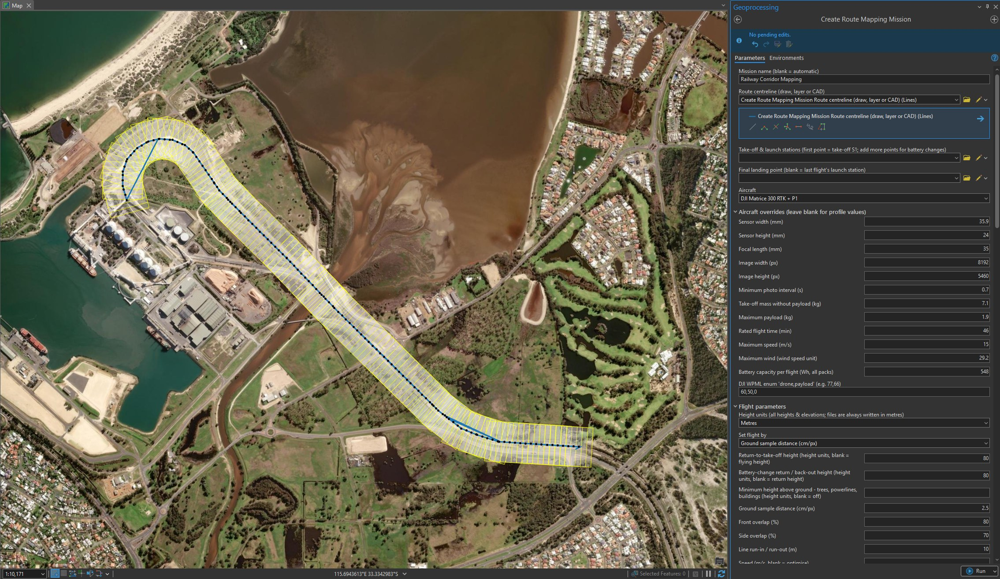

**Tool parameters** – flight parameters, wind in knots, payload, terrain (DEM) · obstacles, output and export
formats incl. the PDF report · corridor widths, auto launch stations, leapfrog and the field schedule

<p>
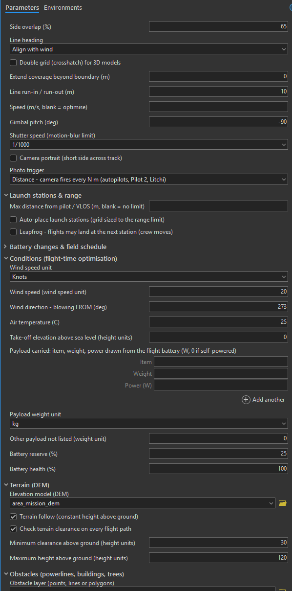
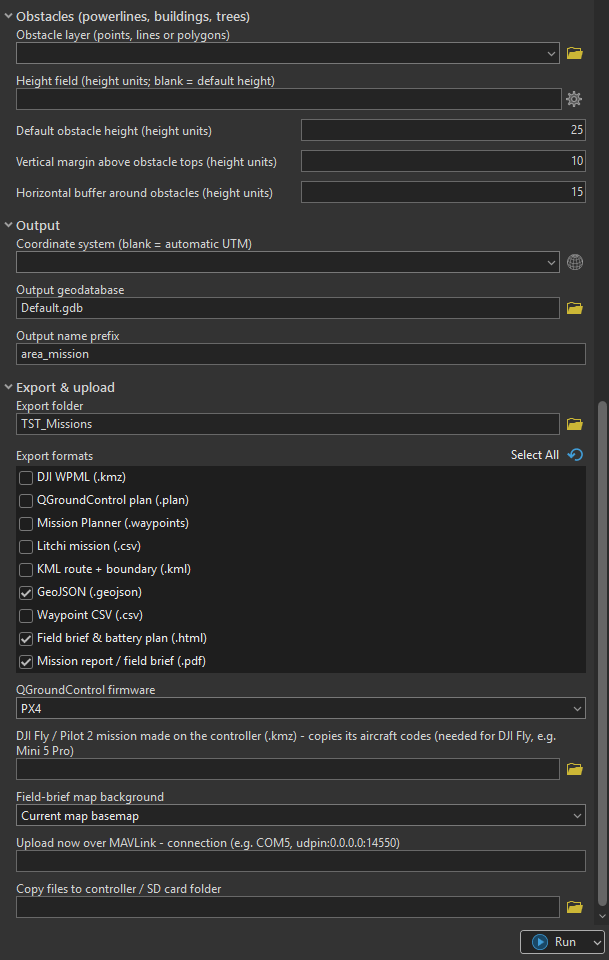
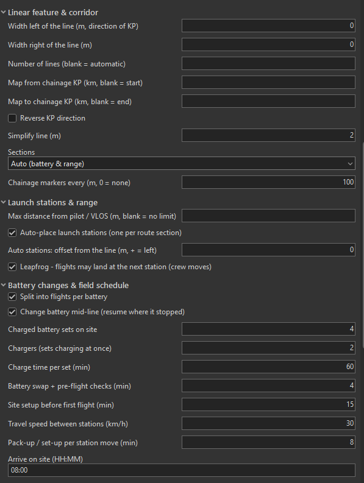
</p>

### Mission report (field brief)

The mission report exports as a **PDF** anyone can open (phone, tablet, PC – prints on A4) or as an
interactive HTML page. Samples: [area report (PDF)](docs/examples/sample_area_report.pdf) ·
[route report (PDF)](docs/examples/sample_route_report.pdf) · [area brief (HTML)](docs/examples/sample_area_brief.html) ·
[route brief (HTML)](docs/examples/sample_route_brief.html).

| | |
|---|---|
| **Summary** – aircraft, heights, GSD, photos, flight time, wind, payload, time on site, battery sets 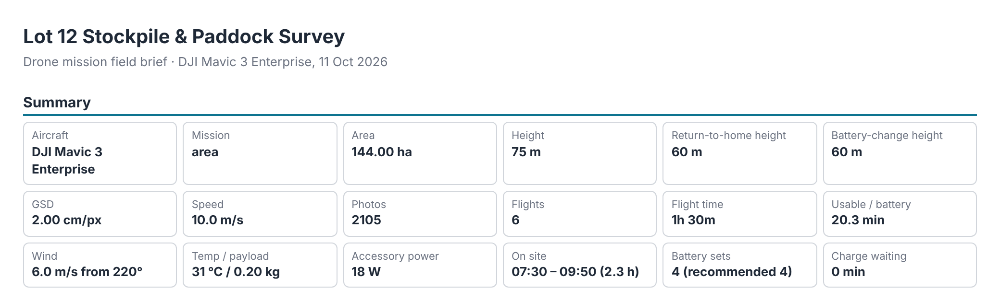 | **Mission map** – every flight numbered and coloured, transits, launch stations, obstacles, scale and north; payload table 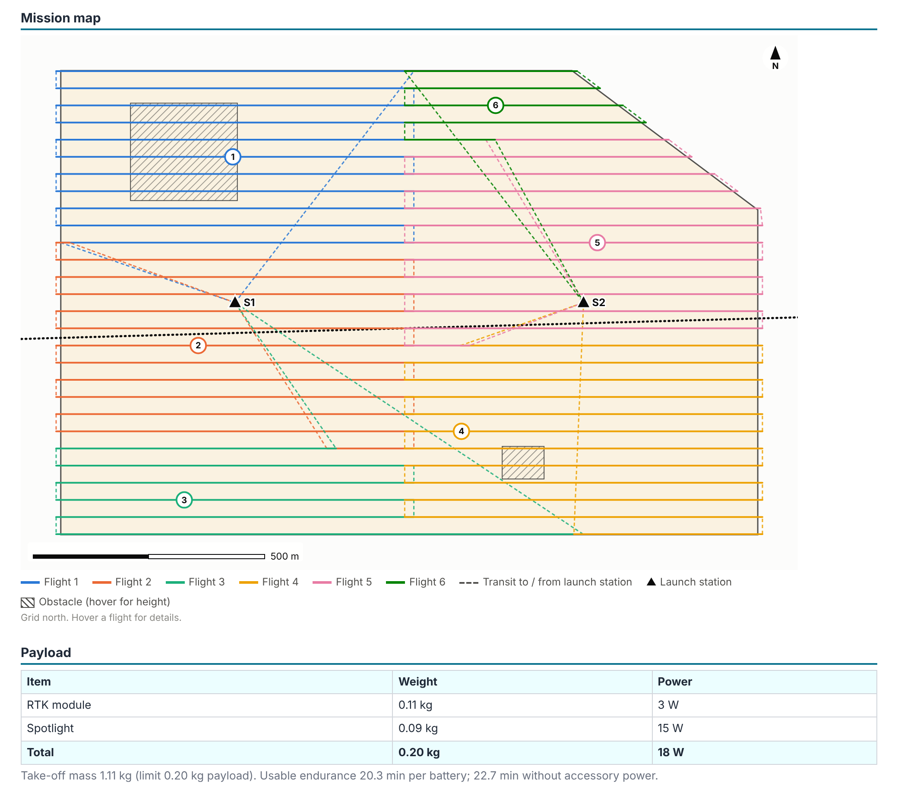 |
| **Launch stations and flights & battery plan** – clock times, battery sets, mid-line battery changes, tick-off column 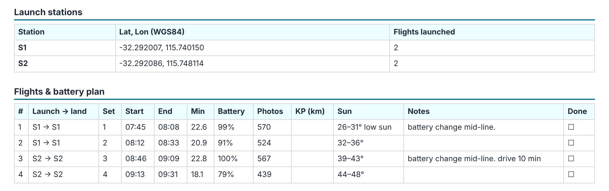 | **Terrain & obstacle check** 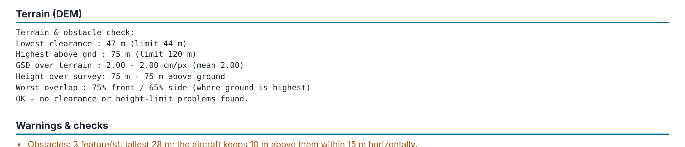 |
| **Route overview map** with chainage 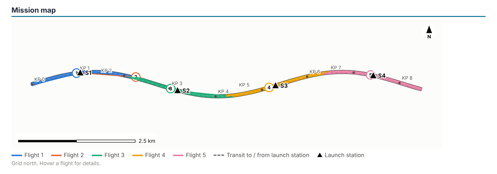 | **Section maps** – one zoomed map per launch station 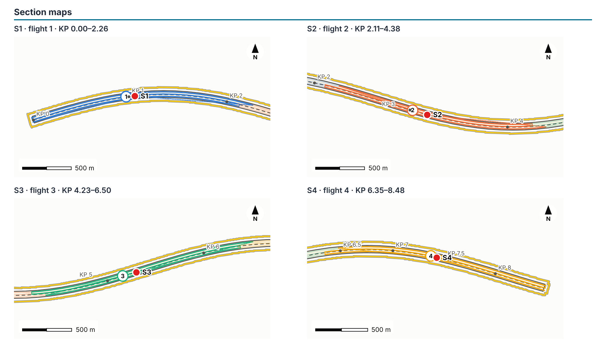 |
| **Route elevation profile** – ground and flight altitude along the KP 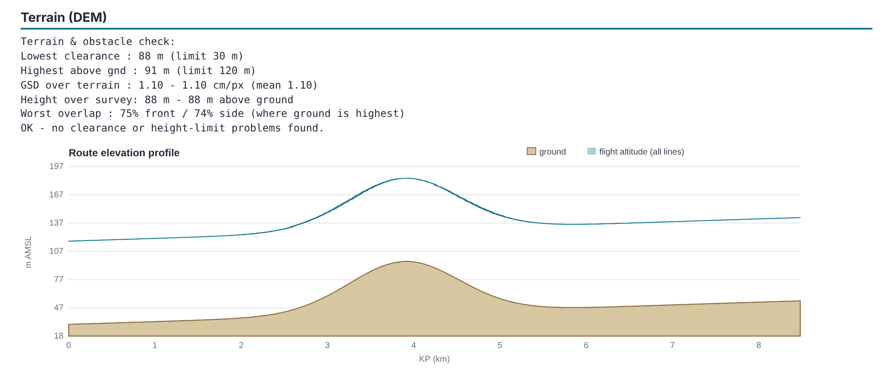 | **PDF report** – page 1 of the area report 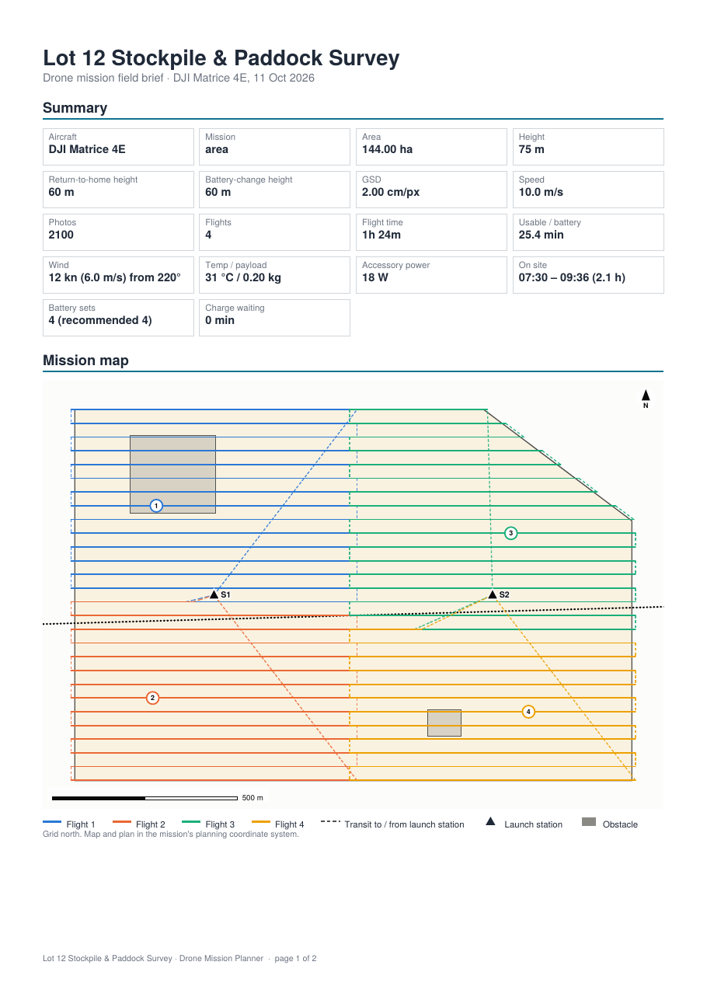 |

The panel images are made by `tools/make_app_screenshots.py` (run it with QGIS's Python) and the report images
by `tools/make_report_screenshots.py` (needs pyproj and Playwright).

---

## Workflow

0. **Mission name** – type one, or leave it blank for an automatic name built from the boundary layer/file
   name (or "Area/Route mission" + date). It titles the field brief and report, names the KML, and is the
   default file name for every export.
1. **Boundary** – choose *Area mapping* (grid) or *Route/corridor mapping* (linear features — see below), then:
   - **Draw** on the map (QGIS: click vertices, right-click/Enter to finish, Backspace undo, Esc cancel;
     ArcGIS: pencil button on the input parameter), or
   - **Import** Shapefile, GeoPackage, GeoJSON, KML/KMZ, GML, MapInfo, FileGDB, CSV, **DXF/DWG CAD**. Closed CAD
     polylines are converted to polygons automatically; files without a CRS are assumed to be in the project/map CRS (you're told when this happens), or
   - **Use an existing layer** (selected features, or all).
2. **Change the boundary** – QGIS: *Edit boundary vertices* (drag/add/delete vertices; the mission re-plans live).
   ArcGIS: edit the output `_boundary` feature class and run the tool again on it.
3. **Take-off, launch stations & landing** – pick the take-off (S1), add more launch stations for battery
   changes, or *Auto-place stations*. An optional final landing point can differ from take-off (DJI missions end
   with *no action* there so the pilot lands). All points can be dragged later and the plan updates.
4. **Coordinate system** – automatic UTM zone, or any projected CRS (MGA2020/GDA2020, State Plane, ETRS89 …).
   Output layers use this CRS; drone files are always WGS84.
5. **Aircraft & camera** – pick a profile: the **DJI Enterprise range** (Matrice 4E/4T, Matrice 4D/4TD and
   3D/3TD dock aircraft, Mavic 3E/3T/3M, Matrice 30/30T, Matrice 350 RTK and 300 RTK with P1 or L1/L2,
   Matrice 400 with P1/L2/L3 – see *DJI Enterprise aircraft*), Phantom 4 RTK, **Mini 3 Pro / Mini 4 Pro /
   Mini 5 Pro**, Air 3, Autel EVO II, generic ArduPilot/PX4 quad and fixed-wing. Every sensor/battery value is
   editable for custom rigs.
6. **Flight parameters** – **height units (metres or feet)**, flying height **or** ground pixel size (GSD; the
   other updates automatically), **return-to-take-off height** and **battery-change height** (see below), **minimum height above
   ground** (see *Minimum height and obstacles*),
   front/side overlap, line heading (auto fewest lines / manual / align with wind), crosshatch for 3D,
   coverage margin, run-in/out, speed (auto-optimised or fixed), gimbal pitch, shutter, portrait camera,
   **photo trigger** (every N m / camera timed shot / stop & shoot — see *DJI Mini Pro series*).
7. **When & conditions** – **flight date, site time zone and arrival time** (see *Flight date & light*), wind speed (**knots** by default; m/s or km/h selectable – the aircraft's max
   wind uses the same unit) & direction, temperature, take-off elevation (or *From DEM*), the
   **payload list** (see below),
   battery reserve & health. **DEM**: pick one you have, or click *Download DEM* (see below) – used for terrain
   following, per-station heights, safe transits, terrain checks and the route profile.
8. **Battery changes & field schedule** – see below.
9. **Plan** – layers: boundary, survey legs, flight routes (coloured per battery, with launch station, battery
   set, clock times and KP range), waypoints, photo centres, the **mission footprint** (optionally every photo's
   footprint), launch stations (red dots), chainage
   markers. The report
   gives GSD, spacing, photo count, time and battery use per flight, plus the field schedule.
10. **Export / upload** (see below), including a printable **field brief** with mission maps drawn over a
    **basemap** (see *Field-brief basemap*).

## Airspace check (aeronautical chart data)

Checks whether the planned mission enters **controlled**, **restricted / prohibited**, **danger / military** or
**uncontrolled** airspace. QGIS: *Airspace check* group; ArcGIS: *Airspace check* parameters.

**Automatic (default):** when you plan, the airspace for the project area (mission + 10 km) is downloaded –
from the **FAA in the USA** (no key) and from **openAIP everywhere else** (enter your free openAIP API key once;
it's remembered). It's downloaded once and re-used while the mission stays inside that area; *Download again
now* refreshes it. Without a key outside the USA, or offline, the report says the airspace was **not checked**.

| Source | What it is |
|---|---|
| **Automatic** (default) | FAA (USA) or openAIP (elsewhere, API key) for the project area, on every plan. |
| **Airspace layer** | Any polygon layer in your project – e.g. Airservices Australia / national AIP shapefiles, FAA downloads, an openAIP export. Fields such as class, type, name and upper/lower limits are recognised automatically (FAA `CLASS`, `UPPER_VAL/UOM/CODE`…, openAIP codes, generic `class`/`type`/`lower`/`upper`). |
| **File** | **OpenAir** (`.txt`/`.air` – the common worldwide airspace format, incl. arcs and circles), **GeoJSON**, or **ED-269** JSON (EU UAS geographical zones). |
| **Download – FAA (USA)** | FAA class airspace, special use airspace, prohibited areas and **UAS facility map** grids (LAANC ceilings) for the mission area. No key. |
| **Download – openAIP** | Worldwide airspace from openAIP. Needs a free API key from openaip.net; check openAIP's data licence before commercial use. |

The check follows **every flight path in 3D** (positions every 25 m; height above sea level from the take-off
elevation or DEM; airspace limits in ft/m AMSL, AGL or flight levels) and reports for each airspace:

- **INSIDE** – the mission enters it: controlled → approval / authorization needed; restricted / prohibited →
  don't enter without the controlling authority's approval; danger / military → check activity and NOTAMs;
  FAA UAS facility map → LAANC ceiling, flagged if the mission flies higher.
- **Below floor** – inside the footprint but under the base (e.g. a CTA step), with the margin in metres.
- **Nearby** – within the distance you set (default 1 km).

Results appear in the panel report, as warnings, in the **Airspace** layer (QGIS, styled by category) or the
`_airspace` feature class (ArcGIS), on the brief/PDF map as dashed outlines, and in an **Airspace** section of
the HTML brief and PDF.

**This is a planning aid, not an authoritative source.** Airspace data can be out of date and doesn't include
NOTAMs or temporary restrictions. Always confirm with your authority's approved tools before flight – in
Australia a CASA-verified drone safety app (which also covers the 5.5 km rule near controlled aerodromes), in
the USA B4UFLY / LAANC, elsewhere the national service.

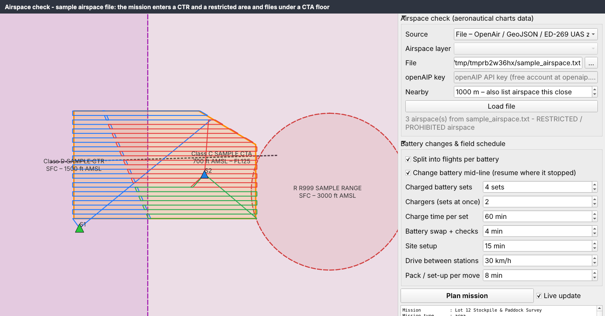

## Flight date & light

Set the **flight date** (QGIS: *When and conditions*; ArcGIS: *Flight date* under Conditions), the site **time
zone** (default: this computer's zone on that date – DST aware – or hours from UTC, e.g. 8 for Perth) and the
**arrival time**. For the site and that date the planner works out, with a built-in solar calculator (NOAA
method, about a minute of accuracy, no internet needed):

- **Civil dawn, sunrise, solar noon, sunset, civil dusk** and the sun's maximum height.
- The **sun height at the start and end of every flight** in the field schedule – in the report, the HTML brief
  and a new *Sun* column of the PDF.
- **Warnings** for flights outside civil twilight (*night* – needs an approval in most jurisdictions, e.g.
  CASA, FAA) and in twilight (before sunrise / after sunset – lighting rules, dark images).
- **Mapping light**: flights with the sun below the minimum height (default 30°, adjustable) are flagged –
  long shadows hurt stitching and 3D – and the **best-light window** (sun above that height) is given.
- A time-zone sanity check (warns if the zone doesn't fit the site's longitude).
- The report and brief show the flight date ("flight date Thu 15 Oct 2026 · prepared 12 Oct 2026"), and the
  automatic mission name uses it.

Weather forecasts and NOTAMs still need checking online before you fly.

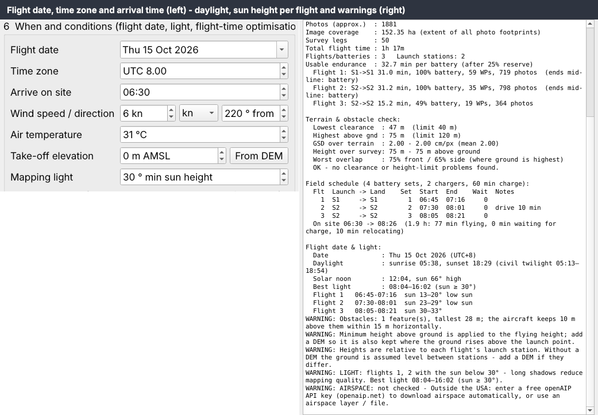

## Mission footprint & image footprints

The **Mission footprint** – the outline of all ground the photos cover – is always calculated and shown as a
**yellow outline with no fill** (QGIS layer *Mission footprint*, ArcGIS `_footprint`, and on the brief / PDF map),
with its area in the report ("Image coverage"). It's traced from the footprints of all photos on a grid aligned
with the flight lines, so it follows the real coverage including staggered line ends and holes.

**Individual photo footprints** are optional – tick *Calculate individual photo footprints* (QGIS: Flight
parameters; ArcGIS: Output). Off by default because large missions have thousands of photos.

When ticked, every photo gets its ground footprint – the rectangle the image covers – in the **Image footprints** layer
(QGIS) or the `_footprints` feature class (ArcGIS), outlined in its flight's colour so overlap and coverage
are easy to check.

- Placed where the camera actually fires along the planned flights (trigger distance, restarting at each line;
  the hover points in stop-and-shoot mode), turned to the flight direction, portrait setting respected.
- Sized from the camera and the **height above ground at that photo** – with a DEM the real ground, so
  footprints shrink over hills and grow over valleys; without one, ground level with the launch station.
- Attributes: flight, photo number, height above ground, GSD, across- and along-track size, heading. Style by
  `gsd_cm` to see resolution vary over terrain, or select a flight to check its coverage.
- Nadir camera assumed (gimbal −90°). Photo centres use the same positions and numbering.

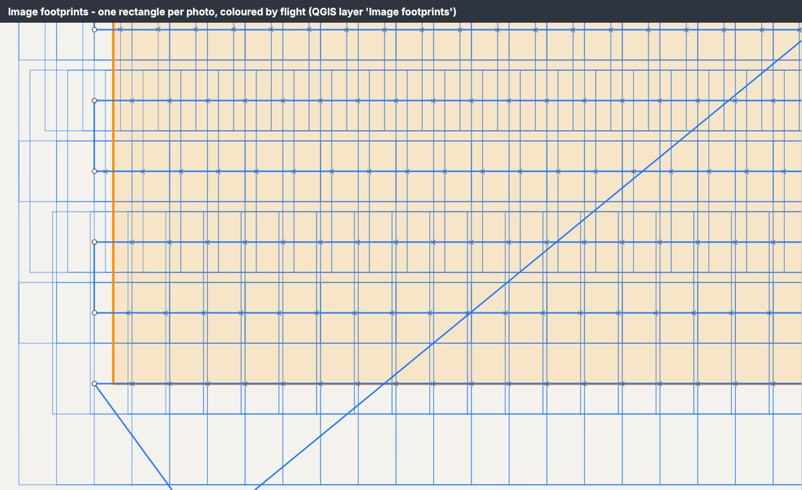

With a DEM, a flat-height plan over rising ground: footprints shrink and the GSD gets finer uphill (layer
styled by `gsd_cm`).

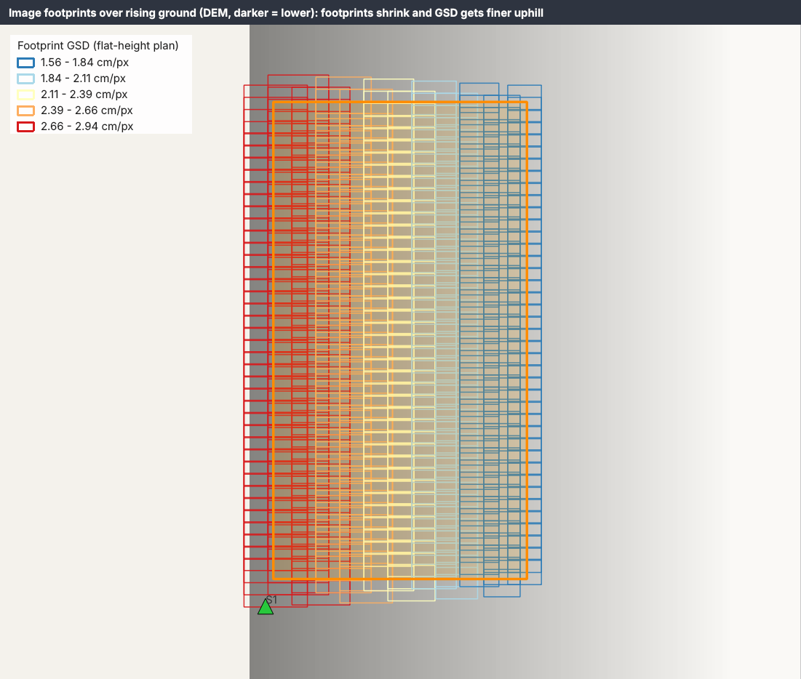

## Big jobs: battery changes & launch stations

Large areas and long routes need many batteries. The planner builds the whole day, not just the flight lines:

- **Mid-line battery changes** – each flight uses its battery fully: when the battery (after reserve) is due,
  the flight stops part-way along a line, returns, and the next battery resumes at that exact point with one
  photo of overlap, so there are no gaps. (Untick it to change batteries only at line ends.)
- **Several launch stations** – add stations by clicking, or *Auto-place stations*: on an area, a grid sized so
  every point is within your range limit; on a route, one per section, offset from the line if you like (e.g.
  onto the access track). Drag them to real access points and the plan updates. The survey is split into
  station zones, each flight launches from the station that owns its part of the survey, and zones are visited
  in a short driving order (several orderings are tried and the best kept).
- **Maximum distance from pilot (VLOS)** – flights are cut where they would go further than this from their
  launch station, exactly like a battery cut, and resumed from a station that can reach the rest.
- **Return or leapfrog** – by default each flight lands back at its own station and the crew drives to the next
  one. *Leapfrog* lets flights land at the next station instead (the crew moves with the aircraft) — less
  driving, but needs the right approvals/crew.
- **Heights per station** – heights are relative to each flight's launch point. With a DEM, each station's
  ground height is used (and terrain following works across stations); without one, a warning reminds you
  that ground is assumed level between stations.
- **Field schedule** – battery sets on site, chargers, charge time, swap/pre-flight time, setup, drive speed and
  pack-up time per move, and arrival time give a clock-time plan: which set flies which flight, waits for
  charging, drives, and total time on site, plus how many battery sets would remove waiting.
- **Mission report / field brief** – two formats with the same content:
  - **PDF** (*Mission report / field brief (.pdf)*) – opens in any PDF reader on any phone, tablet or PC, prints
    on A4, and can be emailed to the client or crew. Maps and the elevation profile are vector graphics, the
    basemap is embedded, page numbers in the footer, tick boxes for each flight. Made in plain Python, so it
    works the same in QGIS and ArcGIS Pro with nothing extra to install.
  - **HTML** (*Field brief & battery plan (.html)*) – the interactive version: hover a flight on the map for its
    times and battery.

  Both show the mission name, summary, **mission map**, station coordinates, payload,
  terrain section and a flight-by-flight table (launch → land, battery set, start/end, battery %, photos, KP
  range, notes) with tick boxes.
  - **Mission map**: boundary/corridor, every flight (survey lines solid, transits dashed) numbered on the map,
    launch stations, final landing, obstacles, terrain warnings, chainage, scale bar and north arrow. Up to 8
    flights get distinct colours; more use a light-to-dark blue in flight order. Hover a flight for its times,
    battery set and %.
  - **Section maps**: routes with several launch stations get a zoomed map per station.
  - **Basemap** under the maps – see *Field-brief basemap*.
- Every flight is exported as its own file with its own home position, ready to fly in order.

## Heights: metres or feet, return-to-take-off and battery-change heights

- **Height units** – choose *Metres* or *Feet* (QGIS: top of *Flight parameters*, remembered between sessions;
  ArcGIS: *Height units*). It applies to every height and elevation you enter or read: flying height,
  return-to-take-off height, battery-change height, take-off elevation, terrain clearance and height limit, the
  report, the field brief and the profile chart. Switching converts the numbers already entered. Mission files
  are always written in metres (what the aircraft expect), so 400 ft becomes exactly 121.92 m.
- **Return-to-take-off height** – the height for the final flight home (blank = flying height). The aircraft
  climbs to it at the last survey point, flies home at that height and lands. It's written as explicit
  waypoints in every format, so it doesn't depend on the aircraft's own RTH setting. On live MAVLink upload the
  autopilot's failsafe return altitude is also set to it (ArduPilot `RTL_ALT`, PX4 `RTL_RETURN_ALT`).
  On DJI, still set the RTH altitude in Pilot 2 for failsafes: the mission flies home at your height, but a
  signal-loss return uses the aircraft setting.
- **Battery-change height** – the height for flights coming home to swap a battery and for the next flight
  flying back out to resume (blank = return height).
- Neither height is ever used to descend over high ground: with a DEM, terrain-safe transits can raise them
  but never lower them. Both appear in the report and brief, and you're warned if one is above 120 m (400 ft).

## Elevation (DEM): download, terrain safety checks, route profile

- **Download DEM** (QGIS: section 6; ArcGIS: *Download DEM* tool, or *If no DEM is given, download one* on the
  mission tools) fetches free elevation for the mission area plus a margin, saves it as a GeoTIFF (QGIS: in a
  `dem` folder next to your project) and loads it. Take-off elevation is filled in from it automatically.
  - **Copernicus GLO-30** – 30 m, global, a *surface* model (includes trees and buildings – the safest choice
    for clearance). Reads only the window you need. Needs GDAL, so QGIS (or ArcGIS with GDAL installed).
  - **AWS Terrain Tiles** – ~10–30 m, global, mostly a *terrain* model from SRTM and national DEMs. Works in
    ArcGIS Pro with no extra installs.
  Missing tiles (open sea) are set to 0 m and you're told. Both are free with no account; attribution is shown
  when loaded. Uses your normal internet connection/proxy.
- **Terrain-safe transits** – with a DEM, the climb-out and the flight home are checked against the ground:
  with terrain following they follow the terrain at the flying height; otherwise they climb just enough to
  clear the highest ground on the way (≥ 30 m or half the flying height). Flights are re-budgeted so the extra
  climbing still fits in the battery.
- **Terrain check** (on by default when a DEM is present) follows every flight's real 3D path – vertical climb,
  transits, survey lines, return – and reports:
  - spots where clearance drops below your minimum (default 30 m) – including flights that would hit a hill;
  - spots above your height limit (default 120 m AGL) where the ground falls away from the launch point;
  - the real GSD range and the worst front/side overlap over the terrain;
  - what to do about it (terrain following, raise height by N m, move the launch point…).
  Problem spots appear as a *Terrain warnings* layer (QGIS) / `_terrain` feature class (ArcGIS) and in the
  report and field brief.
- **Route elevation profile** – ground vs. flight altitude by chainage (KP): a chart in the QGIS panel (hover for
  values), an SVG chart in the field brief, and a `_profile` table in ArcGIS (chart it with *Create Chart ▸
  Line*). Low-clearance spots are marked in red.

## Linear features: roads, pipelines, powerlines, rail, rivers

Choose *Route / corridor mapping*, then:

- **Pick line features on map** – click the pieces of the road/pipeline in any visible line layer (click again to
  drop one; right-click or Enter when done). Pieces in any order or direction — including multi-feature CAD
  or GIS layers via *Use layer* / *Import* — are **chained into one route**, and you're warned about any gap
  bridged between pieces that don't touch.
- **Chainage (KP)** – map just part of a long feature (e.g. KP 2.5 – 9.0), reverse the KP direction if needed,
  and add chainage markers every N metres (labelled `KP 4.500`). Each flight reports the KP range it covers.
- **Corridor shape** – separate widths left and right of the line (e.g. 40 m upslope, 25 m downslope), automatic
  or fixed number of flight lines, and line simplification to remove digitising noise.
- **Sections** – long routes are flown section by section: each section's lines are flown back and forth before
  moving on, so batteries and launch stations line up along the route. Section length is automatic (sized to
  one battery and the range limit), fixed, or off.

## ArcGIS Pro equivalents

The *Create Area/Route Mapping Mission* tools have the same options in parameter groups: the take-off input
accepts several points (first = S1, others = launch stations), *Launch stations & range*, *Battery changes &
field schedule* and (route) *Linear feature & corridor*. Multi-feature line inputs are chained automatically.
Extra outputs: `_site` (stations with S-labels and flight counts), `_chainage` and a `_schedule` table.
To move auto-placed stations, edit `_site` and feed it back as the take-off input.

## Flight-time optimisation

The rated endurance (sea level, 15 °C, no wind, no payload) is scaled by:

- **Payload weight** – lift power ∝ mass^1.5 (heavier = shorter flights).
- **Accessory power** – lights, sensors and other items powered from the flight battery drain it directly,
  on top of the power to fly.
- **Altitude & temperature** – air density (ISA) at take-off elevation + flight height; thin air costs power.
- **Cold batteries** – usable capacity drops below ~20 °C (85 % at 0 °C, 70 % at −10 °C).
- **Wind** – entered in knots (or m/s / km/h); every leg is costed with its real airspeed (multirotor) or ground speed (fixed-wing), so headwind
  legs, tailwind legs and crosswind all count.
- **Reserve & battery health** – always held back.

The planner then picks the **speed that minimises energy per metre** within the camera's limits (photo interval
and motion blur), and **splits the mission into per-battery flights**, each returning to land with the reserve
intact. *Align with wind* heading flies lines into/with the wind, which usually costs less than crosswind
crabbing on windy days. The ArcGIS **Flight Time Calculator** shows usable minutes, area per battery and a wind
sensitivity table before you go to site.

It's a planning estimate: keep a 20–30 % reserve and watch live battery telemetry.

## Minimum height and obstacles (trees, powerlines, buildings)

- **Minimum height above ground** – the lowest the aircraft may ever be: set it above the tree canopy,
  powerlines and buildings on site. If the flying height is lower it is raised to the minimum (you're told the
  new GSD). It also applies to the flight out, battery-change returns and the return home. With a DEM it is
  kept where the ground rises above the launch point (the aircraft climbs only where needed).
- **Obstacle layer** (optional) – any point, line or polygon layer: powerlines and poles, towers and masts,
  building footprints, tree stands. Pick its **height field** (auto-detected for names like `HEIGHT`, `HGT`,
  `BLDG_HT`) or use a **default height** for every feature, then set the **vertical margin** (clearance above
  the tops, default 10 m) and **horizontal buffer** (distance kept sideways, default 15 m). Selected features
  only, if some are selected. Heights are in the chosen height units.
- The aircraft climbs **only where it passes over or near an obstacle** and descends again afterwards; climbs
  start before the obstacle zone and each leg is sampled at every obstacle edge, so even a leg that clips the
  corner of a building's zone is caught. Extra climbing is included in the battery plan.
- A launch station inside an obstacle's buffer gets a warning (the aircraft climbs vertically there – move it
  to open ground).
- The terrain & obstacle check reports any spot closer than your margin to an obstacle top. When a minimum
  height is set, the ground-clearance check uses it as its limit. Obstacles appear on the brief map (hatched
  polygons, dotted lines, point symbols) with heights on hover.
- Tested: a 28 m powerline, 18 m shed, 25 m tree stand and 45 m mast flown at 30 m – clearance measured every
  metre along every flight stays at the 10 m margin; a route through 2,000 building footprints plans in ~4 s.

## Payload list

List everything the aircraft carries – camera or sensor, lights, LiDAR, gimbal, mounts, parachute… – with a
**name**, **weight** and **power drawn from the flight battery** in watts (0 if it has its own battery).

- QGIS: the table in section 6 (*Add item* / *Remove*, double-click to edit, weights in **kg or lb**). The list
  is remembered between sessions. The total turns red if it's over the aircraft's payload limit.
- ArcGIS: the *Payload carried* table on the mission tools and the Flight Time Calculator, with a kg/lb choice
  and an *Other payload not listed* box. The dialog warns when the total is over the limit.
- Both **weight and power** count toward flight time: weight raises the power needed to fly; accessory
  watts are drawn on top for the whole flight, including the climb, the transits and the trip home. Battery
  splitting, the return reserve and the schedule all use the combined figure.
- Power needs the aircraft's **battery capacity (Wh)**, now in the aircraft settings. It's pre-filled from the
  profile; on dual-battery aircraft use both packs together (e.g. M350: 2 × 263 Wh = 526 Wh).
- The report, Flight Time Calculator and field brief list each item, the totals, and endurance with and without
  accessory power. Example: an M350 with a 0.9 kg LiDAR (28 W), a 0.4 kg spotlight (30 W) and a 0.5 kg gas
  sensor (6 W) drops from 31 to 21.3 usable minutes per battery set (22.6 if the items drew no power).
- The mapping camera in a stock profile is already part of the aircraft's take-off weight. List it only if you
  swap it or add a second one.

## DJI Enterprise aircraft

| Profile | Mapping camera (as planned) | GSD at 100 m | Battery / rated time | DJI codes (WPML) |
|---|---|---|---|---|
| Matrice 4E | 4/3" 20 MP, mechanical shutter, 0.5 s | 2.67 cm | 99.5 Wh, 49 min | 99 / 88 / 0 |
| Matrice 4T | 1/1.3" 48 MP wide | 1.77 cm | 99.5 Wh, 49 min | 99 / 89 / 1 |
| Matrice 4D · 4TD (Dock 3) | 4/3" 20 MP · 1/1.3" 48 MP | 2.67 · 1.77 cm | 149.9 Wh, 54 min | 100 / 98 / 0 · 100 / 99 / 1 |
| Matrice 3D · 3TD (Dock 2) | 4/3" 20 MP · 1/1.32" 48 MP | 2.67 · 1.77 cm | 115.2 Wh, 50 min | 91 / 80 / 0 · 91 / 81 / 1 |
| Mavic 3E · 3T · 3M | 4/3" 20 MP · 1/2" (12 MP mode) · 4/3" 20 MP RGB | 2.67 · 3.60 · 2.67 cm | 77 Wh, 45 / 45 / 43 min | 77 / 66 / 0 · 77 / 67 / 1 · 77 / 68 / 2 |
| Matrice 30 · 30T | 1/2" 12 MP wide | 3.56 cm | 2 × 131.6 Wh, 41 min | 67 / 52 / 0 · 67 / 53 / 1 |
| Matrice 350 RTK + P1 · L1 · L2 | P1 35 mm full frame · L1 1" RGB · L2 4/3" RGB | 1.25 · 2.74 · 2.67 cm | 2 × 263.2 Wh, ~45–46 min* | 89 / 50 · 89 / 90742 · 89 / *template* |
| Matrice 300 RTK + P1 · L1 | P1 35 mm · L1 1" RGB | 1.25 · 2.74 cm | 2 × 274 Wh, ~45–46 min* | 60 / 50 · 60 / 90742 |
| Matrice 400 + P1 · L2 · L3 | P1 35 mm · L2 4/3" RGB · L3 100 MP RGB | 1.25 · 2.67 · 1.05 cm | 977 Wh, ~52–59 min* | *template* |

Codes are *drone / payload / sub-type* from DJI's Cloud API documentation; they go into the DJI WPML `.kmz` so
Pilot 2 / FlightHub 2 accept the route. Specs are from DJI's spec pages.

- **\*** Flight time with a gimbal camera is DJI's no-payload time scaled for the camera's weight (an estimate);
  DJI's own figure for the Matrice 400 is 59 min with an H30T. Edit *rated flight time* once you have your own
  numbers.
- **Codes DJI hasn't published** (Matrice 400, Zenmuse L2/L3 payload): create and save any route on the aircraft
  in Pilot 2, copy its `.kmz` to your computer and choose it as the **DJI template** when exporting. The aircraft
  and payload codes are copied from it. You're asked for it automatically for these profiles.
- **P1 lenses**: the profiles use the 35 mm lens; set *focal length* to 24 or 50 mm for the other lenses.
- **LiDAR (L1/L2/L3)**: the plan is sized for the RGB camera's GSD and overlap. Set the side overlap to your
  LiDAR point-density spec (e.g. 50 % for L2 at 100 m) – the planner doesn't model LiDAR scan patterns.
- **Dock aircraft** (Matrice 4D/4TD, 3D/3TD): import the `.kmz` in *FlightHub 2 ▸ Flight Route Library*; the take-off
  point is the dock.
- **Mavic 3T**: planned in 12 MP mode – 48 MP photos can't be timed at 2 s.
- The Phantom 4 RTK profile stays for existing fleets (it uses GS RTK, not Pilot 2 – export KML).

## DJI Mini Pro series

| Profile | Camera (as planned) | Battery | Best way to fly the mission |
|---|---|---|---|
| DJI Mini 3 Pro | 1/1.3" 12 MP, 6.72 mm | 18.1 Wh, 34 min rated | Litchi (DJI SDK supported) – Litchi `.csv` |
| DJI Mini 4 Pro / (Plus battery) | 1/1.3" 12 MP, 6.72 mm | 18.96 Wh 34 min / 28.4 Wh 45 min | Litchi (SDK since 2025, RC-N2 controller) – Litchi `.csv`; or DJI Fly waypoints via *Replace* |
| DJI Mini 5 Pro / (Plus battery) | 1" 12.5 MP binned, 9.1 mm | 19.52 Wh 36 min / 33.51 Wh 52 min | DJI Fly waypoints via *Replace* (no third-party SDK at the time of writing) |

All three are under 250 g, so the weight-based endurance model has no payload headroom – keep accessories off.
Pixel counts are the 12 MP mode (2 s minimum interval); 48/50 MP mode needs ≥5 s between shots, so change
the camera's *image width/height* and *min interval* if you shoot full resolution.

**Photo trigger** (Flight parameters):
- *Every N m* – distance trigger (autopilots, Pilot 2, Litchi). Default for most aircraft.
- *Camera timed shot* – DJI Fly can't fire by distance. The speed is set so the camera's timed interval gives
  the forward overlap; start *Timed shot* on the camera before starting the route. Default for the Mini 5 Pro.
- *Stop & shoot* – a waypoint at every photo with a hover (default 1 s) and *take photo*. Sharpest images and
  works in any app, but slower: the hover, deceleration and re-acceleration are included in flight time and
  battery splitting, and Litchi files split every 99 waypoints.

**Getting a route into DJI Fly** (Mini 4 Pro / Mini 5 Pro): DJI Fly has no import button, so –
1. In DJI Fly on the aircraft's controller, create and save any small waypoint route.
2. Connect the controller (RC 2 / RC-N3 phone) by USB. The route is a `.kmz` in
   `Android/data/dji.go.v5/files/waypoint/<ID>/<ID>.kmz` (iPhone: *Files ▸ DJI Fly ▸ wayline_mission*).
3. Export from the planner as **DJI WPML** – when asked, pick that DJI Fly `.kmz` as the template (the
   aircraft/payload codes are copied from it, so DJI Fly accepts the file). Then *Upload to drone ▸ Replace a
   mission file made in DJI Fly / Pilot 2* and choose the same file. The original is kept as `.bak`.
4. Restart DJI Fly, open the route, and **check every waypoint, height and the end action before flying**.

This replace-the-file method is a community workaround, not supported by DJI; behaviour can change with DJI Fly
updates. Waypoint flight and its limits (e.g. maximum points per route) vary by region and firmware.

## Field-brief basemap

The overview and section maps in the field brief are drawn over a basemap for context (*Export ▸ Brief
basemap* in QGIS; *Field-brief map background* in ArcGIS):

| Choice | What you get |
|---|---|
| **Current map** (default) | QGIS: the layers visible in your map (basemap, imagery, cadastre…), rendered for the exact map extent; if nothing is visible under the mission, OpenStreetMap. ArcGIS Pro: the active map's basemap is matched to the same online service (World Imagery, Topographic, Streets, Light Gray, OpenStreetMap); otherwise OpenStreetMap. |
| OpenStreetMap / Esri World Imagery / Esri World Topographic | Online tiles downloaded at a resolution that suits the map (max 20 tiles per map), cached for the session. |
| None | Plain map (smallest file). |

The provider's attribution is printed on every map. Tiles are placed with their exact corner positions in your
planning CRS, so they line up with the mission even in UTM/MGA. No internet → the brief is still written, with
a plain map and a warning. Use online basemaps within the providers' terms (OpenStreetMap tile policy: light,
interactive use; Esri basemaps: per your ArcGIS licence).

## Getting missions onto the drone

| Aircraft / app | Format | How it gets there |
|---|---|---|
| **ArduPilot** (Mission Planner, QGC) | `.waypoints`, `.plan` | **Live upload** over USB, telemetry radio, Wi-Fi/UDP or TCP (SITL) |
| **PX4** (QGroundControl, Auterion) | `.plan` | **Live upload** (same as above) |
| **DJI Enterprise** – M350/M300, M30, Mavic 3E/3T/3M, M4E/T (Pilot 2) | DJI WPML `.kmz` | Copy to the controller/SD/USB, then *Pilot 2 ▸ Flight Route ▸ Import*; or upload to *FlightHub 2 ▸ Route Library* |
| **DJI Mini 5 Pro** (no SDK yet) – **DJI Fly** waypoints | DJI WPML `.kmz` | *Upload ▸ Replace a mission file made in DJI Fly* (see below) |
| **DJI consumer** – Mini 3 Pro, Mini 4 Pro, Air, Mavic, Phantom via **Litchi** | Litchi `.csv` | Import at *flylitchi.com/hub* (syncs to the app). Split automatically at 99 waypoints |
| **Autel** EVO II / Explorer / Smart Controller | `.kml` | Copy to the controller and import |
| UgCS, Pix4Dcapture, DroneDeploy, Google Earth, any GIS | `.kml`, `.geojson`, `.csv` | Import |

Files are written **one per flight/battery** by default.

**Honest limits:** DJI and Autel don't let third-party desktop software push missions over their radio link, so
for those the plugin writes the file straight onto the controller, SD card or USB stick (the *Upload to drone*
dialog lists removable drives). True over-the-air upload is available for every MAVLink autopilot. Set the DJI
*enum* (drone,payload — e.g. `77,66` for Mavic 3E) to match your aircraft or Pilot 2 may refuse the route.
Always check the mission in the flight app before flying, and comply with local rules (CASA in Australia,
120 m AGL limit unless approved — the planner warns above it).

## What's in the box

```
drone_mission_planner/          QGIS plugin
  plugin.py  dock.py  maptools.py  layers.py  profile_widget.py  metadata.txt  icon.png
  dronemapper_core/             shared engine
DroneMissionPlanner/            ArcGIS Pro
  DroneMissionPlanner.pyt       5 tools: Area mission, Route mission, Flight Time Calculator, Upload Mission,
                                Download DEM
  dronemapper_core/             shared engine
dronemapper_core/
  drones.py          aircraft & camera profiles
  photogrammetry.py  GSD ⇄ height, footprint, spacing, trigger distance, blur limits
  geometry.py        scan-line grid, auto heading, corridor offsets, line chaining, chainage, simplification
  performance.py     endurance model (wind, temperature, altitude, payload, battery)
  planner.py         mission building, speed optimisation, stations & zones, mid-line/range splitting,
                     route sections, terrain follow
  logistics.py       field schedule: battery sets, chargers, charge/swap/drive times
  dem.py             DEM download (Copernicus GLO-30, AWS Terrain Tiles), PNG decoder, fast sampler
  terrain.py         terrain clearance / height-limit checks, GSD over terrain, route profile
  exporters.py       DJI WPML, QGC .plan, Mission Planner, Litchi, KML, GeoJSON, CSV, field brief (HTML)
  airspace.py        airspace: OpenAir / GeoJSON / ED-269 / layers, FAA & openAIP download, 3-D mission check
  daylight.py        flight date: sun position, sunrise/sunset, twilight, sun height per flight
  footprints.py      photo positions along the flights and image footprints (terrain-aware)
  pdfreport.py       mission report as PDF (pure-Python PDF writer, SVG maps drawn as vector)
  uploader.py        MAVLink upload (live or from file), copy-to-device, replace a DJI Fly mission
  basemap.py         online basemap tiles (OSM, Esri) for the field-brief maps
  briefmap.py        field-brief maps (SVG)
  obstacles.py       obstacle index & clearance heights
```

## Testing done

- Core: concave polygons with holes, auto/manual/wind heading, crosshatch, corridors, terrain following,
  fixed-wing stall-speed floor; all export formats written and XML/JSON validated.
- MAVLink: planned missions and exported `.plan`/`.waypoints` files uploaded to a simulated autopilot over
  UDP with MAVLink 1 and 2 — every item received and acknowledged.
- QGIS 3.34: the real plugin loaded and driven end-to-end — draw, pick, live re-plan on parameter and
  vertex edits, manual CRS, DXF import, DEM terrain following, route mode, all exports, upload dialog, unload.
- ArcGIS Pro toolbox: all tools executed against a functional `arcpy` stand-in in the automated tests, including
  CAD input, DEM sampling and validation messages; area and route missions have also been planned in ArcGIS Pro
  itself on real sites (see *Screenshots ▸ ArcGIS Pro*).
- v1.1 battery & linear features: a 400 ha block (2 stations and an auto-placed 4-station grid with a 1 km VLOS
  limit) and a 25 km pipeline supplied as shuffled, reversed pieces (chainage window, asymmetric widths,
  11 auto stations). Checked: survey length flown ≥ planned (no gaps at battery changes), no flight over 100 %
  battery, no point beyond the range limit, one home position per launch station in the exports, sensible
  schedules. Driven through the real QGIS panel too, including clicking road pieces on the map and dragging a
  station to trigger a re-plan.
- v1.2 DEM: downloads tested against a local server that mimics both services exactly (Cloud-Optimised
  GeoTIFF range reads, missing ocean tiles, real PNG encodings) – sampled heights within 0.01 m of the true
  surface; the pure-Python PNG decoder matches Pillow on every PNG filter type. The real servers were not
  reachable from the build machine, so the first live download is on your machine. Terrain checks verified
  on synthetic ridges, valleys and hills (flags a flight that would hit the hill at −94 m clearance; with
  terrain following everything stays at the set height, transits included). Driven through the QGIS panel
  (Download DEM for both sources, checks layer, profile chart, brief) and the ArcGIS tools.
- v1.3 heights: feet entry converts exactly to metres in every exported format; separate return and
  battery-change heights flown as explicit waypoints; battery budgets include the extra climbs; the failsafe
  RTL altitude was set and confirmed on simulated ArduPilot and PX4 autopilots; unit switching tested in the
  QGIS panel and the ArcGIS tool.
- v1.4 payload: endurance verified to use exactly 100 % of the usable battery with accessory load; weight-only
  results identical to the previous single payload figure; table editing, kg/lb switching, the over-limit
  warning and the saved list tested in QGIS; the value table and calculator output tested in ArcGIS.
- v1.5–1.6: brief maps checked visually in Chromium (area with terrain warnings, 11-station pipeline with
  section maps, aerial background, obstacles); mission names in QGIS and ArcGIS; minimum height and obstacle
  clearance verified by sampling every metre of every flight.
- v1.7: Mini 3/4/5 Pro profiles; distance / timed / stop-and-shoot exports checked in DJI WPML (hover +
  take-photo per point, aircraft codes from a DJI Fly template) and Litchi; replace-file round trip with
  `.bak`; basemap tiles positioned and checked visually in Chromium, offline fallback, QGIS current-map
  fallback to OSM, ArcGIS basemap matching. Tile servers were not reachable from the build machine (tiles were
  simulated), so the first live basemap download is on your machine.
- v1.8: every DJI Enterprise profile planned and exported to DJI WPML with the expected aircraft / payload /
  sub-type codes; profiles without published codes take them from a Pilot 2 template.
- v1.8: PDF report validated with qpdf and text-extracted (title, wind, flights, attribution) with palette-PNG,
  RGB/RGBA-PNG and JPEG basemap tiles and with QGIS-rendered backgrounds; wind entered in knots converts
  exactly to m/s for planning and back when the unit is switched.
- v1.9: image footprints – photo count matches the plan, front overlap measured from consecutive footprints
  equals the setting, footprints shrink with height above ground on a slope (DEM).
- v1.10: sun position checked against the astral library (elevation identical to 0.01°, sunrise/sunset/
  twilight within 1 min for Perth, London, Denver and Tromsø); night, twilight and low-sun flights flagged;
  date, time zone and arrival driven in the QGIS panel and the ArcGIS tool.
- v1.11: OpenAir (polygons, arcs, circles), FAA field layouts, openAIP codes and ED-269 zones parsed; inside /
  below-floor / nearby verified in 3D (a CTA step becomes 'inside' when the mission climbs above its base); UAS
  facility-map ceiling flagged; driven in QGIS (file, layer, download) and ArcGIS. The FAA and openAIP servers
  weren't reachable from the build machine (simulated responses), so the first live download is on your machine.
- v1.12: footprint extent matches the union of all photo footprints (area and outline checked for rectangular,
  L-shaped, angled and route missions); individual footprints only when ticked; automatic airspace picks FAA in
  the USA and openAIP elsewhere, re-uses the download and reports 'not checked' when unavailable.
- Not yet flown on real aircraft: run a short test mission (or ArduPilot SITL) before production work.

## Development

```
dronemapper_core/          shared planning engine (edit here - the single source of truth)
qgis/drone_mission_planner/  QGIS plugin (UI)
arcgis/DroneMissionPlanner/  ArcGIS Pro Python toolbox
tools/build.py             copies the engine into both plugins and writes dist/*.zip
tests/                     test scripts, a headless QGIS iface, an arcpy stand-in, sample DEM/CAD data
docs/examples/             example mission reports (PDF) and field briefs (HTML)
docs/screenshots/          README images (tools/make_*_screenshots.py)
docs/releases/             release notes (v1.7.0 – v1.12.0)
```

```
python tools/build.py              # bundle + build dist/drone_mission_planner_qgis.zip and the ArcGIS zip
python tests/run_tests.py core     # engine + ArcGIS stand-in tests (pyproj; DEM tests also need GDAL, numpy)
python tests/run_tests.py          # everything, run with QGIS's Python for the QGIS UI tests
```

**Releasing:** bump `version=` in `qgis/drone_mission_planner/metadata.txt`, `__version__` in
`dronemapper_core/__init__.py` and `TOOLBOX_VERSION` in `DroneMissionPlanner.pyt`, add `docs/releases/vX.Y.Z.md`, then either `git tag vX.Y.Z && git push origin vX.Y.Z` or *GitHub ▸ Actions ▸ release ▸ Run workflow*.
The *release* workflow checks the versions match, runs the engine tests, builds both zips and publishes the
GitHub release with those notes.

The bundled `dronemapper_core` copies inside the plugin folders are generated by `tools/build.py` and are not
committed. GitHub Actions runs the engine tests on every push and attaches the built zips to the run.

## License

Copyright (C) 2026 the Drone Mission Planner authors.

This program is free software; you can redistribute it and/or modify it under the terms of the GNU General
Public License version 2 as published by the Free Software Foundation. It is distributed in the hope that it
will be useful, but WITHOUT ANY WARRANTY; without even the implied warranty of MERCHANTABILITY or FITNESS FOR A
PARTICULAR PURPOSE. See [LICENSE](LICENSE) for the full text (GPL-2.0).
